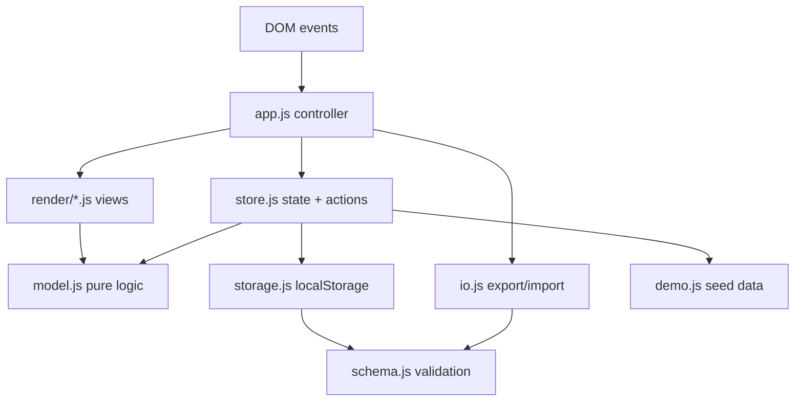

# Design Document: SubCrypt

## Overview

SubCrypt is a static single-page app written in plain HTML, CSS, and JavaScript ES modules. It has no build step and no runtime dependencies, so the repository root can be served directly by GitHub Pages.

The code separates pure domain logic (dates, money, classification, validation) from browser concerns (storage, DOM rendering, animation). Pure modules take `today` as an argument instead of reading the clock, which keeps them deterministic and easy to test.

Visual styling follows `.kiro/steering/design-tokens.md`. All colors, fonts, spacing, glows, and motion timings come from CSS custom properties defined there.

### Key decisions

| Decision | Choice | Reason | Alternatives considered |
|---|---|---|---|
| Framework | Vanilla JS ES modules | Zero build, zero dependencies, trivial GitHub Pages deploy, small app (~8 features) | Vite + Preact/Svelte: nicer components, but adds a build and a Pages workflow |
| Rendering | Full re-render of each region from state via small DOM helper functions | Small data set (≤ 500 items); simple mental model | Keyed diffing: unnecessary at this size, except for animations (handled explicitly) |
| Money | Integer cents | Avoids floating-point drift in totals | Floats rounded at display: error-prone across sums |
| Dates | `YYYY-MM-DD` strings, compared as local calendar dates | Renewal is a calendar concept; avoids time-zone shifts from `Date` ISO parsing | Timestamps: off-by-one around midnight and DST |
| Past renewal dates | Roll forward by Cycle on load | The subscription keeps charging, so the next real charge is the useful date | Showing "overdue": misleading for auto-renewing subscriptions |
| Import mode | Replace after confirmation | Simple and predictable; merge needs conflict rules | Merge by id: out of MVP scope |
| Fonts | Self-hosted OFL fonts in `assets/fonts/` | Meets the "no external requests" rule | Google Fonts CDN: external request |

## Architecture



Data flow is one-directional: a DOM event calls a store action, the action updates state and persists it, then the store notifies the controller, which re-renders the affected regions.

### File layout

```
/index.html               App shell, landmarks, dialog templates
/404.html                 Redirect to index (GitHub Pages)
/css/tokens.css           CSS custom properties from design-tokens.md
/css/base.css             Reset, typography, layout, focus styles
/css/graveyard.css        Sky, moon, fog, candles, ground
/css/tombstone.css        Tombstone states, ghosts, sinking animation
/css/components.css       Dashboard, banner, forms, dialogs, RIP section
/js/app.js                Bootstraps, wires events, owns render loop
/js/store.js              In-memory state, actions, subscribe/notify
/js/model.js              Pure: dates, money, classification, totals, epitaph
/js/schema.js             Pure: field and file validation
/js/storage.js            localStorage read/write, backup, fallback
/js/io.js                 Export download, import file reading
/js/demo.js               Demo data relative to today
/js/render/dom.js         Tiny element-creation helper (textContent only)
/js/render/graveyard.js   Tombstone list + empty state
/js/render/tombstone.js   Single tombstone element
/js/render/dashboard.js   Burn dashboard
/js/render/banner.js      Haunting banner
/js/render/rip.js         RIP section
/js/render/dialogs.js     Add form, confirm dialog, focus trap
/assets/fonts/            Self-hosted OFL font files
/assets/svg/              Moon, ghost, candle, tombstone silhouettes
```

## Components and Interfaces

### `model.js` (pure)

```js
// Dates (all 'YYYY-MM-DD' strings in local calendar terms)
todayISO(now = new Date()) -> string
daysBetween(fromISO, toISO) -> integer          // to - from, in whole days
addCycle(dateISO, cycle) -> string               // month-end clamped (Req 5.2)
rollForward(dateISO, cycle, todayISO) -> string  // smallest date >= today

// Money (integer cents)
monthlyCents(sub) -> integer   // yearly: Math.round(price / 12)
yearlyCents(sub) -> integer    // monthly: price * 12
formatUSD(cents) -> string     // "$1,234.50"
formatUSDShort(cents) -> string// "$39" when whole, else "$39.50" (epitaphs)

// Classification
isZombie(sub, todayISO) -> boolean   // Req 3.1
hauntDays(sub, todayISO) -> integer | null  // 0..7 when Haunting, else null
renewalLabel(days) -> string         // "Renews today" / "tomorrow" / "in N days"
confirmedLabel(sub, todayISO) -> string

// Aggregates
totals(subs, todayISO) -> { monthlyCents, yearlyCents, deadMonthlyCents, savedYearlyCents }
hauntingSummary(subs, todayISO) -> { count, dueCents, ids }
epitaph(sub) -> string               // "RIP MoonMusic — saved $39/year"
sortForGraveyard(subs) -> subs[]     // nextRenewal asc, then name (Req 1.4)
```

`monthlyCents` for yearly subscriptions rounds per subscription. Totals sum those rounded values, so the dashboard always equals the sum of the per-tombstone figures shown to the user.

### `schema.js` (pure)

```js
validateDraft(formValues) -> { ok: true, value } | { ok: false, errors: { field: message } }
validateSubscription(obj) -> { ok: true, value } | { ok: false, reason }
validateExportFile(text, byteSize) -> { ok: true, subs } | { ok: false, message }
```

`validateSubscription` rejects unknown `status`, `cycle`, or `category` values, non-integer or out-of-range `priceCents`, invalid dates, names outside 1–40 characters, and duplicate ids. It drops unknown extra properties.

### `store.js`

```js
createStore({ storage, now }) -> {
  getState() -> { subs, storageOk, bannerDismissedKey, notice }
  subscribe(fn) -> unsubscribe
  addSubscription(draft)
  confirmStillUsing(id)
  bury(id)
  replaceAll(subs)          // import + reset demo
  dismissBanner(key)
  clearNotice()
}
```

Every mutating action calls `storage.save(subs)` and then notifies subscribers. `now` is injectable for testing and for the demo.

### `storage.js`

```js
KEY = 'subcrypt:v1'
BACKUP_KEY = 'subcrypt:v1:backup'
load() -> { status: 'empty' | 'ok' | 'corrupt' | 'unavailable', subs }
save(subs) -> boolean
```

- `empty`: key missing, so the app seeds demo data (Req 11.1).
- `corrupt`: raw value copied to `BACKUP_KEY`, app starts empty with a notice (Req 9.3).
- `unavailable` or a failed `save`: app keeps running in memory and shows a notice (Req 9.4).

### `io.js`

- `exportFile(subs, now)`: builds the Export File, creates a `Blob`, and triggers a download through a temporary `<a download>`.
- `readImportFile(file)`: rejects files over 1 MB before reading, reads with `file.text()`, and passes the text to `validateExportFile`.

### Rendering

- `dom.js` exports `h(tag, attrs, ...children)`. Children that are strings become text nodes. It never uses `innerHTML` for data, which covers Req 10.7.
- Each render function takes state plus `todayISO` and returns a DOM subtree. `app.js` replaces the region's children.
- Tombstones carry `data-id`. Before a re-render, `app.js` records which ids are mid-animation and skips replacing them until `animationend` fires (or immediately under reduced motion).

### Burial animation sequence

1. User confirms burial in the dialog.
2. `app.js` adds the `is-sinking` class to the tombstone (`--motion-sink` duration).
3. On `animationend`, or immediately when `prefers-reduced-motion: reduce` matches, it calls `store.bury(id)`.
4. The re-render removes the tombstone from the Graveyard and adds the entry to the RIP Section with a short fade-in.

The store updates after the animation, so a reload mid-animation leaves the subscription unburied, which is safe.

### Haunting banner dismissal

The banner key is the sorted list of Haunting ids joined by commas. Dismissal stores that key in memory only. When the set changes, the key changes and the banner shows again (Req 4.4).

### Dialogs

The app uses the native `<dialog>` element with `showModal()`. This gives focus containment, Escape to close, and an inert background. On close, focus returns to the opener (Req 12.6). There are two dialogs: Add Subscription and a generic Confirm dialog for burial, import, and demo reset.

## Data Models

### Subscription

```ts
type Subscription = {
  id: string;               // crypto.randomUUID()
  name: string;             // trimmed, 1–40 chars
  priceCents: number;       // integer, 1..10_000_000
  cycle: 'monthly' | 'yearly';
  nextRenewal: string;      // 'YYYY-MM-DD'
  category: Category;
  status: 'active' | 'idle' | 'buried';
  lastConfirmed: string;    // 'YYYY-MM-DD'
  createdAt: string;        // 'YYYY-MM-DD'
  buriedAt?: string;        // 'YYYY-MM-DD', present only when buried
  savedYearlyCents?: number;// snapshot at burial, present only when buried
};

type Category =
  'Entertainment' | 'Music' | 'Video' | 'Storage' | 'Fitness' |
  'Productivity' | 'News' | 'Gaming' | 'Other';
```

`savedYearlyCents` is stored at burial, not derived later, so the saved total stays stable if the formula changes.

### Persisted value (`subcrypt:v1`)

```json
{ "version": 1, "subscriptions": [ /* Subscription */ ] }
```

### Export File

```json
{
  "format": "subcrypt",
  "version": 1,
  "exportedAt": "2026-11-25T10:00:00.000Z",
  "subscriptions": [ /* Subscription */ ]
}
```

### Demo data (relative to Today = T)

| Name | Price | Cycle | Category | Status | Next renewal | Last confirmed | Shows |
|---|---|---|---|---|---|---|---|
| StreamPeak | $15.99 | monthly | Video | active | T+18 | T−3 | Healthy |
| CloudVault | $9.99 | monthly | Storage | active | T+3 | T−5 | Haunting |
| FitGhost | $29.99 | monthly | Fitness | active | T+5 | T−47 | Zombie + Haunting |
| MoonMusic | $39.00 | yearly | Music | buried | T+120 | T−60 | RIP, "saved $39/year" |

A fifth healthy entry is unnecessary; four entries cover every state listed in Req 11.3.

## Error Handling

| Situation | Behavior | Message |
|---|---|---|
| Invalid form field | Inline error, focus first invalid field | Per Req 2.5–2.7 |
| Corrupt saved data | Backup raw value, start empty | `Your saved graveyard was unreadable. A backup was kept.` |
| Storage unavailable or quota exceeded | In-memory mode, persistent notice | `Saving is unavailable in this browser. Export your data to keep it.` |
| Import file > 1 MB | Reject before reading | `Import failed: file is larger than 1 MB.` |
| Import not JSON | Reject | `Import failed: the file is not valid JSON.` |
| Wrong format or version | Reject | `Import failed: this is not a SubCrypt v1 export.` |
| More than 500 entries | Reject | `Import failed: more than 500 subscriptions.` |
| Invalid entry | Reject whole file | `Import failed: entry N is invalid ({reason}).` |
| `crypto.randomUUID` missing | Fall back to `Date.now()` + random suffix | None |

Notices appear in a single dismissible status area with `role="status"`.

## Security

- No network calls. A `Content-Security-Policy` meta tag restricts sources: `default-src 'self'; img-src 'self' data:; style-src 'self'; script-src 'self'; object-src 'none'; base-uri 'none'`.
- All user and imported text is inserted with `textContent` or text nodes.
- Import validation is strict (allow-listed enums, length and range limits, size cap) and drops unknown properties.

## Accessibility

- Landmarks: `header` (title, actions), `main` (banner, dashboard, graveyard), `section[aria-labelledby]` for the RIP Section.
- Each Tombstone is an `article` with a heading (name) and a visually hidden summary, for example `CloudVault, $9.99 per month, renews in 3 days, zombie`.
- Decorative layers use `aria-hidden="true"`.
- All motion is wrapped in `@media (prefers-reduced-motion: no-preference)`, so reduced motion is the default fallback.
- The tilt for Zombie Tombstones is a static transform and stays under reduced motion. The glow stays too, but without pulsing.

## Testing Strategy

Pure modules (`model.js`, `schema.js`) hold the risky logic and can be tested in Node without a DOM. Tests are optional for the hackathon MVP and listed as optional tasks:

- Unit tests with Node's built-in `node:test`, which needs no dependencies: month-end clamping, roll-forward, zombie threshold at 29/30 days, haunt window at 0/7/8 days, totals, epitaph formatting, import validation cases.
- Manual checklist in `tasks.md` covering each requirement in Chrome, Firefox, and Safari, plus reduced motion and keyboard-only passes.

## Deployment

- GitHub Pages serves the `main` branch root. `index.html` lives at the root.
- A `.nojekyll` file disables Jekyll processing.
- All asset paths are relative, so the app works under the `/subcrypt/` project path.
- `.gitignore` excludes only OS and editor files and never `.kiro/`.
