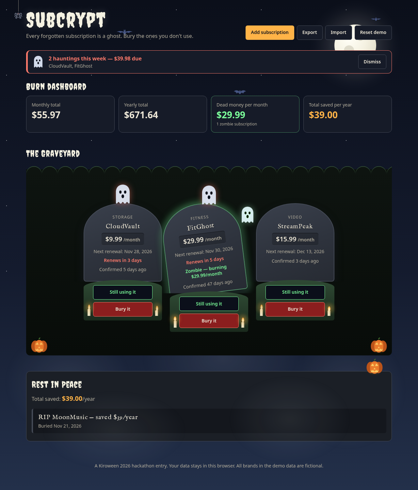
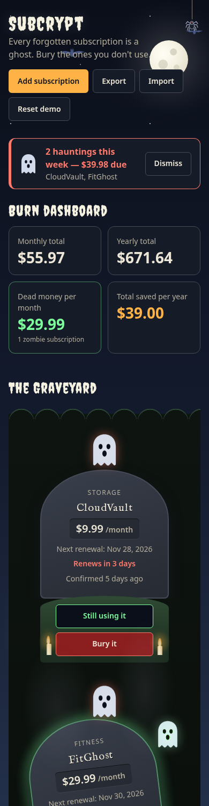

# SubCrypt

**Your forgotten subscriptions are ghosts. Bury them.**

SubCrypt turns subscription management into a moonlit graveyard. Each subscription is a tombstone. The ones you've stopped using rise as zombies, the ones about to renew summon ghosts, and the ones you cancel are buried with an epitaph that tells you how much you saved.

Built for the **Kiroween 2026** hackathon, **Costume Contest** category.

**Live demo:** https://ikun1986.github.io/subcrypt/ (available once GitHub Pages is enabled for this repo)





## What it does

- **Graveyard:** every subscription is a tombstone showing name, price, billing cycle, category and next renewal, under a moon, drifting fog and flickering candles.
- **Zombie subscriptions:** idle, or not confirmed in 30+ days. The tombstone tilts, glows green and gets a ghost, plus a text badge: `Zombie — burning $29.99/month`.
- **Haunting alerts:** renewing within 7 days. A ghost floats above the tombstone and a banner reads `2 hauntings this week — $39.98 due`.
- **Burial:** `Bury it` asks for confirmation, sinks the tombstone into the ground, and moves it to **Rest in Peace** with an epitaph like `RIP MoonMusic — saved $39/year`.
- **Burn dashboard:** monthly total, yearly total, dead money per month (zombies only), and total saved per year.
- **Still using it:** resets the idle timer and lifts the zombie curse.
- **Your data stays with you:** saved in `localStorage`, with JSON export and import. No backend, no accounts, no network requests.

- **Halloween touches:** jack-o'-lanterns with flickering light, bats flapping across the sky, a spider that drops from the header, twinkling stars. All inline SVG and CSS, purely decorative, and still when `prefers-reduced-motion` is on.

All brands in the demo data are fictional: MoonMusic, CloudVault, StreamPeak, FitGhost.

## Run it

No build step. Serve the repository root with any static file server:

```sh
npx serve .
# or
python3 -m http.server 8000
```

Then open the printed address. Opening `index.html` directly from disk won't work because browsers block ES modules on `file://`.

Run the unit tests (Node 20+, no dependencies):

```sh
npm test
```

## Deploy to GitHub Pages

In the repository settings, open **Pages**, choose **Deploy from a branch**, then select `main` and `/ (root)`. All asset paths are relative and `.nojekyll` is included, so the app works under `/subcrypt/`.

## Built with Kiro

This project was built spec-first. The specs and steering are committed in [`.kiro/`](.kiro/):

| File | Purpose |
|---|---|
| [`.kiro/specs/subcrypt/requirements.md`](.kiro/specs/subcrypt/requirements.md) | 13 requirements with EARS acceptance criteria |
| [`.kiro/specs/subcrypt/design.md`](.kiro/specs/subcrypt/design.md) | Architecture, data model, error handling, security |
| [`.kiro/specs/subcrypt/tasks.md`](.kiro/specs/subcrypt/tasks.md) | Ordered implementation plan mapped to requirements |
| [`.kiro/steering/design-tokens.md`](.kiro/steering/design-tokens.md) | The graveyard design tokens, included in every Kiro interaction |

The CSS custom properties in [`css/tokens.css`](css/tokens.css) mirror the steering file.

## Project layout

```
index.html            App shell
css/                  tokens, base, graveyard scene, tombstones, components
js/model.js           Pure logic: dates, money, zombie/haunting rules, totals
js/schema.js          Validation for the form, saved data and import files
js/store.js           State, actions, persistence
js/render/            DOM views (text nodes only, never innerHTML)
assets/               Self-hosted fonts (OFL) and SVGs
tests/                node:test unit tests
```

## Privacy and security

- No server and no analytics. A Content Security Policy blocks every request that isn't to the app's own files.
- Imported files are validated strictly (size, format, version, entry count, per-field checks) and all text is rendered as plain text.

## Accessibility

Keyboard operable with visible focus, native dialogs with focus handling, state shown as text and never by color or motion alone, decorative layers hidden from assistive technology, and all animation disabled under `prefers-reduced-motion`.

## Credits

Fonts: [Creepster](assets/fonts/LICENSE-Creepster.txt) and [IM Fell English](assets/fonts/LICENSE-IMFellEnglish.txt), both under the SIL Open Font License 1.1.
